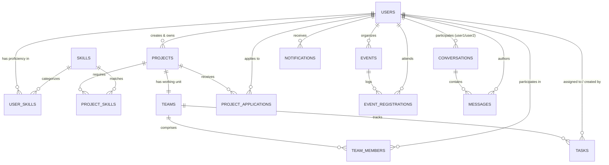

# SkillSync — Intelligent Campus Collaboration Platform

<p align="center">
  
  
  
  
  
</p>

> **Tagline:** *Find your people. Build something extraordinary.*  
> **Developed by:** **Fuzail Khan** ([fuzailk05@gmail.com](mailto:fuzailk05@gmail.com) • [GitHub: @fuzzu05](https://github.com/fuzzu05))

---

## 🌐 Live Cloud Deployment (Try It Live)

The backend is fully deployed, containerized, and running 24/7 on Render connected to a cloud PostgreSQL database (Supabase):

| Resource | Live Link |
| :--- | :--- |
| **🚀 Interactive Swagger UI** | **[https://skillsync-5wgx.onrender.com/swagger-ui.html](https://skillsync-5wgx.onrender.com/swagger-ui.html)** |
| **📄 OpenAPI 3 JSON Specification** | **[https://skillsync-5wgx.onrender.com/v3/api-docs](https://skillsync-5wgx.onrender.com/v3/api-docs)** |
| **🌐 Base Service URL** | `https://skillsync-5wgx.onrender.com` |

*(Note: If the instance is idle, it may take a few seconds on the very first request while the container wakes up).*

### Quick Test via Swagger UI
1. Open the [Swagger UI](https://skillsync-5wgx.onrender.com/swagger-ui.html).
2. Go to **Authentication** $\rightarrow$ `POST /api/v1/auth/register` $\rightarrow$ Click **Try it out** and submit the sample JSON payload.
3. Call `POST /api/v1/auth/login` to obtain your stateless JWT bearer token.
4. Click the green **Authorize 🔒** button at the top right of the Swagger UI page, paste your token, and test any protected endpoint!

---

## 🚀 Overview

**SkillSync** is an enterprise-grade campus collaboration backend platform designed to solve student talent fragmentation. It enables university students to showcase verified proficiencies, form high-impact project teams, manage Kanban-style taskboards, participate in campus hackathons/workshops, communicate through secure 1-on-1 direct messaging, and receive transparent recommendations via a proprietary **explainable skill-matching engine**.

---

## 🛠️ Technology Stack

- **Runtime & Language:** Java 21 (LTS)
- **Framework:** Spring Boot 4.1.1 (Spring MVC, Spring Data JPA, Spring Security, Spring Validation)
- **Database:** PostgreSQL (Flyway-managed migrations `V1` & `V2`), H2 in-memory database for zero-setup unit/integration testing
- **Cloud Hosting & DB:** Docker on Render Web Services + Supabase Cloud PostgreSQL
- **Authentication & Security:** Stateless JWT (HMAC-SHA256 via JJWT 0.12.6) with granular role and resource-level authorization
- **Documentation:** OpenAPI 3 / Swagger UI
- **Testing & Quality:** JUnit 5, AssertJ, and Mockito
- **CI/CD & Monitoring:** GitHub Actions keep-alive automated ping workflow

---

## 🏛️ Architecture & Database Design

SkillSync is architected strictly according to the **3-Tier Layered Architecture** (`Controller` $\rightarrow$ `Service` $\rightarrow$ `Repository`):

- **Controller Layer:** Handles HTTP routing, Swagger annotations, request parameter validation, and status codes.
- **Service Layer:** Encapsulates business logic, transaction boundaries (`@Transactional`), and algorithmic calculations.
- **Repository Layer:** Spring Data JPA persistence interfaces communicating with PostgreSQL.
- **DTO Layer:** Decouples internal database entities from external client JSON contracts.

### Entity-Relationship Diagram



### Core Business & Security Rules
1. **Explainable Skill Matcher:** Uses weighted proficiency scores and mandatory skill multipliers to compute transparent match percentages and gap breakdowns (no black-box AI).
2. **Safe Concurrency on Team Capacity:** Application acceptances acquire a pessimistic write lock on the project to prevent exceeding `maxTeamSize` under race conditions.
3. **Atomic Team & Leader Assignment:** Project creation and initial team leader assignment execute atomically within the same database transaction.
4. **Canonical 1-on-1 Direct Messaging:** Enforces canonical user ordering (`user1_id < user2_id`) preventing duplicate conversation threads.
5. **Participant Authorization:** Every messaging operation strictly validates that the caller is a participant of the conversation.

---

## 🔌 API Endpoint Directory (`/api/v1`)

### Authentication & Profiles
| Method | Endpoint | Description | Auth Required |
| :--- | :--- | :--- | :--- |
| `POST` | `/api/v1/auth/register` | Register new student account | Public |
| `POST` | `/api/v1/auth/login` | Login and obtain stateless JWT access token | Public |
| `GET` | `/api/v1/auth/me` | Fetch authenticated user profile & skills | Yes |
| `GET` | `/api/v1/users/{id}` | View public student profile | Yes |
| `PUT` | `/api/v1/users/profile` | Update profile bio, headline, department | Yes |
| `PUT` | `/api/v1/users/skills` | Configure skills, proficiency, experience | Yes |
| `GET` | `/api/v1/users` | Search talent directory by query | Yes |

### Skills Taxonomy
| Method | Endpoint | Description | Auth Required |
| :--- | :--- | :--- | :--- |
| `GET` | `/api/v1/skills` | List skills by category or keyword search | Public |
| `POST` | `/api/v1/skills` | Suggest new skill into taxonomy | Yes |

### Projects & Team Applications
| Method | Endpoint | Description | Auth Required |
| :--- | :--- | :--- | :--- |
| `POST` | `/api/v1/projects` | Create project & team (auto-assigns leader) | Yes |
| `GET` | `/api/v1/projects` | Browse open projects with filters & paging | Public |
| `GET` | `/api/v1/projects/{id}` | Get project details, required skills, team | Public |
| `PUT` | `/api/v1/projects/{id}` | Edit project (Owner only) | Yes |
| `DELETE` | `/api/v1/projects/{id}` | Delete project (Owner only) | Yes |
| `GET` | `/api/v1/projects/{id}/team` | View team members roster | Yes |
| `POST` | `/api/v1/projects/{id}/apply` | Apply to join project with pitch | Yes |
| `GET` | `/api/v1/projects/{id}/applications` | Review applications (Owner only) | Yes |
| `PATCH` | `/api/v1/projects/{id}/applications/{appId}` | Accept or reject application | Yes |
| `DELETE` | `/api/v1/projects/{id}/applications` | Withdraw pending application | Yes |
| `GET` | `/api/v1/applications/my-applications` | Track submitted applications | Yes |

### Team Tasks (Kanban)
| Method | Endpoint | Description | Auth Required |
| :--- | :--- | :--- | :--- |
| `POST` | `/api/v1/teams/{teamId}/tasks` | Create task (Team members only) | Yes |
| `GET` | `/api/v1/teams/{teamId}/tasks` | List team tasks (Status filter) | Yes |
| `PUT` | `/api/v1/tasks/{taskId}` | Edit task details or reassign | Yes |
| `PATCH` | `/api/v1/tasks/{taskId}/status` | Update task status (TODO/IN_PROGRESS/DONE) | Yes |
| `DELETE` | `/api/v1/tasks/{taskId}` | Remove task (Creator or Leader) | Yes |
| `GET` | `/api/v1/tasks/my-tasks` | Get all assigned tasks across teams | Yes |

### Campus Events
| Method | Endpoint | Description | Auth Required |
| :--- | :--- | :--- | :--- |
| `POST` | `/api/v1/events` | Publish hackathon, workshop, or demo day | Yes |
| `GET` | `/api/v1/events` | Browse upcoming campus events | Public |
| `GET` | `/api/v1/events/{id}` | View event schedule & venue | Public |
| `PUT` | `/api/v1/events/{id}` | Update event (Organizer only) | Yes |
| `DELETE` | `/api/v1/events/{id}` | Delete event (Organizer only) | Yes |
| `POST` | `/api/v1/events/{id}/register` | Enroll for event (Capacity enforced) | Yes |
| `DELETE` | `/api/v1/events/{id}/register` | Cancel event attendance | Yes |
| `GET` | `/api/v1/events/my-registrations` | View enrolled events | Yes |

### 1-on-1 Direct Messaging
| Method | Endpoint | Description | Auth Required |
| :--- | :--- | :--- | :--- |
| `POST` | `/api/v1/conversations/direct/{userId}` | Get or start direct chat with student | Yes |
| `GET` | `/api/v1/conversations` | List conversation threads with unread counts | Yes |
| `GET` | `/api/v1/conversations/{id}/messages` | View paginated chat history | Yes (Participant) |
| `POST` | `/api/v1/conversations/{id}/messages` | Send direct message (triggers alert) | Yes (Participant) |
| `POST` | `/api/v1/conversations/{id}/read` | Mark thread as read | Yes (Participant) |

### Notifications
| Method | Endpoint | Description | Auth Required |
| :--- | :--- | :--- | :--- |
| `GET` | `/api/v1/notifications` | Activity notifications feed | Yes |
| `PATCH` | `/api/v1/notifications/{id}/read` | Mark notification as read | Yes |
| `PATCH` | `/api/v1/notifications/read-all` | Mark all notifications as read | Yes |
| `GET` | `/api/v1/notifications/unread-count` | Unread badge count | Yes |

### Explainable Skill Matchmaking
| Method | Endpoint | Description | Auth Required |
| :--- | :--- | :--- | :--- |
| `GET` | `/api/v1/matches/projects` | Recommend projects for current student | Yes |
| `GET` | `/api/v1/matches/projects/{id}/candidates` | Recommend collaborators for project | Yes |

---

## 💻 Running Locally

### Prerequisites
- **JDK 21** or **JDK 17** installed
- **PostgreSQL** running locally on port 5432 (or Docker)

### 1. Clone the Repository
```bash
git clone https://github.com/fuzzu05/skillsync.git
cd skillsync/backend
```

### 2. Configure Local Database
Ensure PostgreSQL has a database named `skillsync`:
```sql
CREATE DATABASE skillsync;
```
*(By default, `application.yaml` connects to `localhost:5432/skillsync` with password `1234` or reads `SPRING_DATASOURCE_PASSWORD`)*.

### 3. Run the Application
- **Windows (PowerShell):**
  ```powershell
  .\mvnw.cmd spring-boot:run
  ```
- **macOS / Linux:**
  ```bash
  chmod +x mvnw
  ./mvnw spring-boot:run
  ```

### 4. Open Local Swagger UI
Once running, visit:
👉 **`http://localhost:8080/swagger-ui.html`**

---

## 🐳 Running with Docker Locally

```bash
# Build the Docker image
docker build -t skillsync .

# Run the container
docker run -p 8080:8080 \
  -e SPRING_DATASOURCE_URL="jdbc:postgresql://<your-db-host>:5432/skillsync" \
  -e SPRING_DATASOURCE_USERNAME="postgres" \
  -e SPRING_DATASOURCE_PASSWORD="your-password" \
  skillsync
```

---

## 🧪 Running Automated Tests

Run the full integration and unit test suite (using the isolated in-memory H2 database profile):

```bash
cd backend
.\mvnw.cmd test
```

---

## 👤 Author & Contact

**Fuzail Khan**  
- **Email:** [fuzailk05@gmail.com](mailto:fuzailk05@gmail.com)  
- **GitHub:** [@fuzzu05](https://github.com/fuzzu05)  
- **Project Repository:** [https://github.com/fuzzu05/skillsync](https://github.com/fuzzu05/skillsync)

---

## 📄 License

This project is licensed under the **MIT License** — see the [LICENSE](LICENSE) file for details.  
Copyright (c) 2026 Fuzail Khan.
