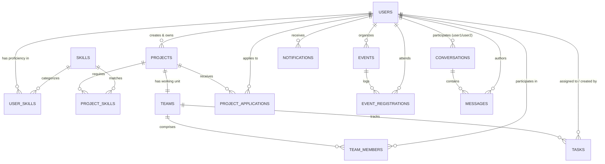

# SkillSync — Intelligent Campus Collaboration Platform

> **Tagline:** *Find your people. Build something extraordinary.*  
> **Author:** **Fuzail Khan** ([fuzailk05@gmail.com](mailto:fuzailk05@gmail.com) • [GitHub: @fuzzu05](https://github.com/fuzzu05))  
> **Live API & Swagger:** [https://skillsync-5wgx.onrender.com/swagger-ui.html](https://skillsync-5wgx.onrender.com/swagger-ui.html)

---

## 🚀 Overview

**SkillSync** is a full-stack campus collaboration platform built to solve the fragmentation of student talent on campus. It enables students to showcase verified proficiencies, form high-impact project teams, manage tasks through team taskboards, participate in campus events, communicate via secure 1-on-1 direct messaging, and receive transparent recommendations via an **explainable skill-matching engine**.

---

## 🛠️ Technology Stack

- **Runtime & Language:** Java 21 (LTS)
- **Framework:** Spring Boot 4.1.1 (Spring MVC, Spring Data JPA, Spring Security, Spring Validation)
- **Database:** PostgreSQL (Flyway-managed migrations `V1` & `V2`), H2 in-memory for zero-setup integration testing
- **Authentication & Security:** Stateless JWT (HMAC-SHA256 via JJWT 0.12.6) with granular role and resource-level authorization
- **Documentation:** OpenAPI 3 / Swagger UI (`/swagger-ui.html`)
- **Testing:** JUnit 5, AssertJ, and Mockito

---

## 🏛️ Architecture & Database Design

### Normalized Entities & Junction Tables
SkillSync is strictly normalized with 9 core domain entities, 1 dedicated supporting workflow entity, and 4 junction tables:



### Core Business & Security Rules Implemented
1. **Single Application Rule:** Students can submit only one application per project across all states (`uk_project_applicant` constraint).
2. **Safe Concurrency on Team Capacity:** Application acceptances acquire a pessimistic write lock on the project to prevent exceeding `maxTeamSize` under concurrent reviews.
3. **Atomic Team & Leader Assignment:** Project creation and initial team leader assignment execute atomically within the same database transaction (`@Transactional`).
4. **Strict 1-on-1 Direct Messaging:** Enforces canonical user ordering (`user1_id < user2_id`) preventing duplicate conversation threads.
5. **Participant Authorization:** Every messaging operation (reading, sending, read receipts, unread badges) strictly validates that the caller is a participant of the conversation.
6. **Explainable Skill Matcher:** Uses weighted proficiency scores and mandatory skill multipliers to compute transparent match percentages and gap breakdowns (no fake AI).

---

## 🔌 API Endpoint Directory (`/api/v1`)

### Authentication & Profiles
| Method | Endpoint | Description | Auth Required |
| :--- | :--- | :--- | :--- |
| `POST` | `/api/v1/auth/register` | Register new student account | Public |
| `POST` | `/api/v1/auth/login` | Login and obtain stateless JWT access token | Public |
| `GET` | `/api/v1/auth/me` | Fetch authenticated user profile & skills | Yes |
| `GET` | `/api/v1/users/{id}` | View public student profile | Yes |
| `PUT` | `/api/v1/users/profile` | Update profile bio, headline, department | Yes |
| `PUT` | `/api/v1/users/skills` | Configure skills, proficiency, experience | Yes |
| `GET` | `/api/v1/users` | Search talent directory by query | Yes |

### Skills Taxonomy
| Method | Endpoint | Description | Auth Required |
| :--- | :--- | :--- | :--- |
| `GET` | `/api/v1/skills` | List skills by category or keyword search | Public |
| `POST` | `/api/v1/skills` | Suggest new skill into taxonomy | Yes |

### Projects & Team Applications
| Method | Endpoint | Description | Auth Required |
| :--- | :--- | :--- | :--- |
| `POST` | `/api/v1/projects` | Create project & team (auto-assigns leader) | Yes |
| `GET` | `/api/v1/projects` | Browse open projects with filters & paging | Public |
| `GET` | `/api/v1/projects/{id}` | Get project details, required skills, team | Public |
| `PUT` | `/api/v1/projects/{id}` | Edit project (Owner only) | Yes |
| `DELETE` | `/api/v1/projects/{id}` | Delete project (Owner only) | Yes |
| `GET` | `/api/v1/projects/{id}/team` | View team members roster | Yes |
| `POST` | `/api/v1/projects/{id}/apply` | Apply to join project with pitch | Yes |
| `GET` | `/api/v1/projects/{id}/applications` | Review applications (Owner only) | Yes |
| `PATCH` | `/api/v1/projects/{id}/applications/{appId}` | Accept or reject application | Yes |
| `DELETE` | `/api/v1/projects/{id}/applications` | Withdraw pending application | Yes |
| `GET` | `/api/v1/applications/my-applications` | Track submitted applications | Yes |

### Team Tasks (Kanban)
| Method | Endpoint | Description | Auth Required |
| :--- | :--- | :--- | :--- |
| `POST` | `/api/v1/teams/{teamId}/tasks` | Create task (Team members only) | Yes |
| `GET` | `/api/v1/teams/{teamId}/tasks` | List team tasks (Status filter) | Yes |
| `PUT` | `/api/v1/tasks/{taskId}` | Edit task details or reassign | Yes |
| `PATCH` | `/api/v1/tasks/{taskId}/status` | Update task status (TODO/IN_PROGRESS/DONE) | Yes |
| `DELETE` | `/api/v1/tasks/{taskId}` | Remove task (Creator or Leader) | Yes |
| `GET` | `/api/v1/tasks/my-tasks` | Get all assigned tasks across teams | Yes |

### Campus Events
| Method | Endpoint | Description | Auth Required |
| :--- | :--- | :--- | :--- |
| `POST` | `/api/v1/events` | Publish hackathon, workshop, or demo day | Yes |
| `GET` | `/api/v1/events` | Browse upcoming campus events | Public |
| `GET` | `/api/v1/events/{id}` | View event schedule & venue | Public |
| `PUT` | `/api/v1/events/{id}` | Update event (Organizer only) | Yes |
| `DELETE` | `/api/v1/events/{id}` | Delete event (Organizer only) | Yes |
| `POST` | `/api/v1/events/{id}/register` | Enroll for event (Capacity enforced) | Yes |
| `DELETE` | `/api/v1/events/{id}/register` | Cancel event attendance | Yes |
| `GET` | `/api/v1/events/my-registrations` | View enrolled events | Yes |

### 1-on-1 Direct Messaging
| Method | Endpoint | Description | Auth Required |
| :--- | :--- | :--- | :--- |
| `POST` | `/api/v1/conversations/direct/{userId}` | Get or start direct chat with student | Yes |
| `GET` | `/api/v1/conversations` | List conversation threads with unread counts | Yes |
| `GET` | `/api/v1/conversations/{id}/messages` | View paginated chat history | Yes (Participant) |
| `POST` | `/api/v1/conversations/{id}/messages` | Send direct message (triggers alert) | Yes (Participant) |
| `POST` | `/api/v1/conversations/{id}/read` | Mark thread as read | Yes (Participant) |

### Notifications
| Method | Endpoint | Description | Auth Required |
| :--- | :--- | :--- | :--- |
| `GET` | `/api/v1/notifications` | Activity notifications feed | Yes |
| `PATCH` | `/api/v1/notifications/{id}/read` | Mark notification as read | Yes |
| `PATCH` | `/api/v1/notifications/read-all` | Mark all notifications as read | Yes |
| `GET` | `/api/v1/notifications/unread-count` | Unread badge count | Yes |

### Explainable Skill Matchmaking
| Method | Endpoint | Description | Auth Required |
| :--- | :--- | :--- | :--- |
| `GET` | `/api/v1/matches/projects` | Recommend projects for current student | Yes |
| `GET` | `/api/v1/matches/projects/{id}/candidates` | Recommend collaborators for project | Yes |

---

## 🏃 Getting Started Locally

### Prerequisites
- JDK 21+
- PostgreSQL (or run default tests using in-memory H2)

### Configuration
Update [src/main/resources/application.yaml](file:///d:/clg/Engineering/FSD/SkillSync/src/main/resources/application.yaml) or set environment variables:
```bash
export DB_URL=jdbc:postgresql://localhost:5432/skillsync
export DB_USERNAME=postgres
export DB_PASSWORD=postgres
export JWT_SECRET=your-secure-256-bit-secret-key-here
```

### Running the Application
```bash
./mvnw spring-boot:run
```

### Running Tests
```bash
./mvnw test
```

### Accessing Swagger Documentation
Once running, open your browser to:
```
http://localhost:8080/swagger-ui.html
```
Use the **Authorize** button in Swagger with Bearer token obtained from `/api/v1/auth/login`.
